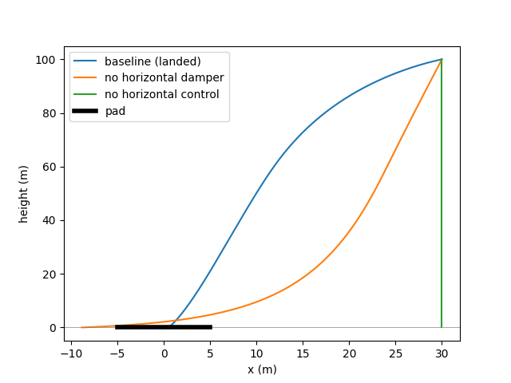
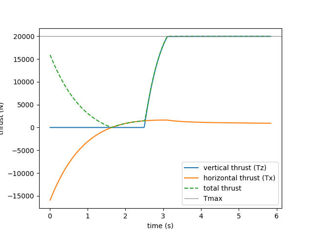

# lander-c

2D powered landing simulator in plain C. A lander starts above and to the side of a landing pad, and a PD controller fires the engine to bring it down on the pad. Each run ends with LANDED or CRASHED plus the reason.

## Build and run

You need a C11 compiler, make, and Python 3 with numpy and matplotlib for the plots. On Windows (MSYS2) use mingw32-make instead of make.

    mkdir -p output
    make
    ./main
    make test
    python3 scripts/plot_path.py
    python3 scripts/plot_worst.py

## Model

The lander is a point mass in x and z with no rotation. State is (x, z, vx, vz, m), integrated with fixed step RK4 at dt = 0.01 s.

    dx/dt  = vx
    dz/dt  = vz
    dvx/dt = Tx / m
    dvz/dt = Tz / m + g
    dm/dt  = -|T| / (Isp * g0)

g = -9.81, Isp = 300 s, g0 = 9.80665, Tmax = 20000 N. Thrust is clamped so |T| <= Tmax and Tz >= 0. If the command is too big, both components get scaled down together.

The controller is PD on each axis with gravity compensation on z:

    Tz = m * (Kp_z * (z_target - z) - Kd_z * vz - g)
    Tx = m * (-Kp_x * x - Kd_x * vx)

z_target is -1 m instead of 0, because a PD law aimed at exactly 0 slows down as it gets close and may never cross it. Baseline gains are Kp_x = 0.5, Kd_x = 1.4, Kp_z = 1.0, Kd_z = 2.0.

A landing counts if vertical speed is under 2 m/s, horizontal speed is under 1 m/s, and it touches down within 5 m of the pad center. Otherwise it reports the first check that failed. No touchdown after 60 s is a timeout.

No malloc anywhere, no globals, and fixed size structs passed by pointer, since that's how flight software is usually written. The random number generator is a small xorshift with its state in a struct, because rand() has hidden global state and gives different sequences on different platforms.

## Validation

Free fall from 100 m compared against z = z0 + v0 t + 0.5 g t^2, max position error over the fall:

    method   dt = 0.1    dt = 0.01
    Euler    2.26 m      0.222 m
    RK4      6.4e-14 m   2.1e-12 m

Euler's error drops about 10x when dt drops 10x, so it's first order. RK4 is exact for constant acceleration, so what's left is floating point round-off, which is why it's slightly larger at the smaller step (452 steps instead of 45).

Constant 20000 N burn with gravity off, 1000 kg down to about 800 kg. The simulated velocity change matches the rocket equation, Isp * g0 * ln(m0 / mf), to six decimal places (656.488 m/s). Tests also check that mass never increases and thrust never goes over Tmax.

## Results

Vertical landing from 100 m with three gain settings:

    Kp=1, Kd=2   touchdown 0.86 m/s   landed
    Kp=1, Kd=0   touchdown 43.5 m/s   crashed
    Kp=2, Kd=2   touchdown 24.5 m/s   crashed

Kd is what does the braking. Doubling Kp made it worse, because while the lander is high the spring term asks for downward acceleration, thrust gets clamped to zero, and a stiffer spring keeps it clamped longer.

Starting 30 m off the pad at 100 m up, the baseline gains land 0.51 m from center with vz = -0.86 m/s and vx = -0.32 m/s, using 30.6 kg of propellant over 8.36 s. Setting Kd_x to 0 crashes on horizontal speed (6.42 m/s), and turning off horizontal control entirely misses the pad by 30 m.

Monte Carlo with N = 1000, seed 42, baseline gains. Starting conditions are uniform over altitude 80 to 120 m, x offset -40 to 40 m, vz -10 to 0 m/s, vx -3 to 3 m/s, and mass 900 to 1100 kg.

    landed            964 (96.4%)
    vertical speed     32
    horizontal speed    4
    missed pad          0
    timeout             0

Same seed gives the same numbers every run.

The worst failure (run 646, touchdown at 7.10 m/s) started at 119.9 m, already falling at 7.11 m/s, at 1096 kg, and drifting away from the pad. I re-flew it with logging:

Vertical thrust stays at zero until about 2.5 s, then sits at Tmax for the rest of the descent. So the engine was at full power the whole time it was braking and still couldn't stop in time. Braking just started too late for a heavy lander coming in high and fast. That's the main failure mode, late braking and then saturation.

## Things that went wrong along the way

The landing loop originally never ended, because the controller aimed at z = 0 and never quite got there. Moving the target to -1 m fixed it.

Doubling Kp making landings worse surprised me until I plotted it and saw thrust stuck at zero for longer.

After moving the landing loop into its own function, I typed /n instead of \n in the CSV output, so every row ended up on one line. I found it when the plot script couldn't read the file.

For the worst failure, my first guess was that horizontal thrust was stealing braking from the vertical channel. Plotting the thrust showed the sideways part cost less than 1% of the vertical thrust, so that wasn't it.

The RK4 error comes out as 2.112921e-12 on Windows (MinGW gcc) and 2.105677e-12 on macOS (Apple clang), since different compilers round slightly differently. That's why the tests compare against tolerances and never exact values.

## Next

Start braking based on the stopping distance needed instead of a fixed spring and damper, so the lander slows down as soon as it has to. After that, add rotation (pitch with a gimbal limit), and sensor noise and wind to see how the success rate changes.